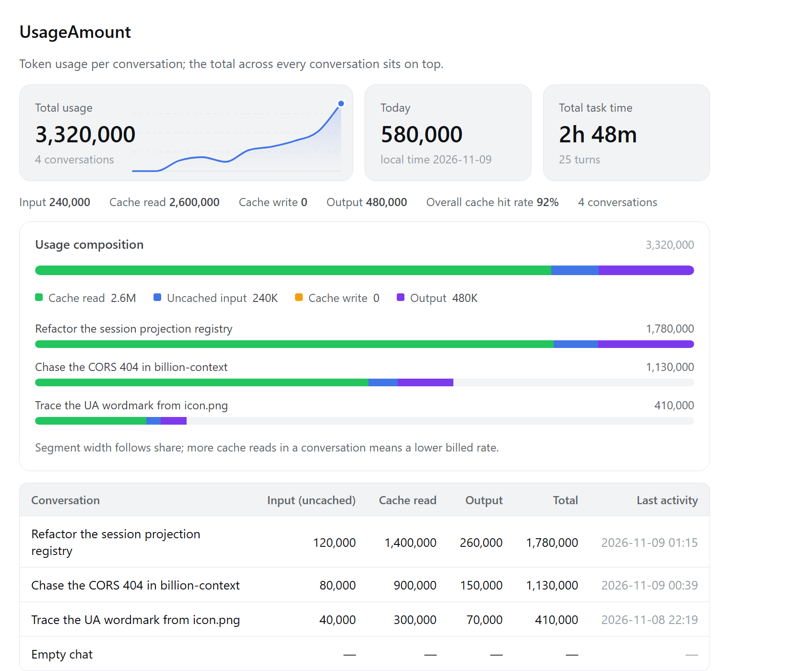
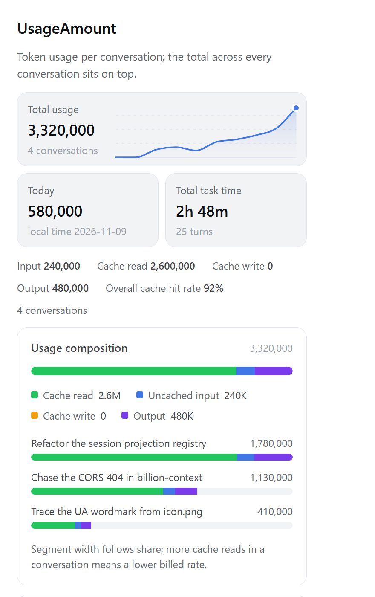
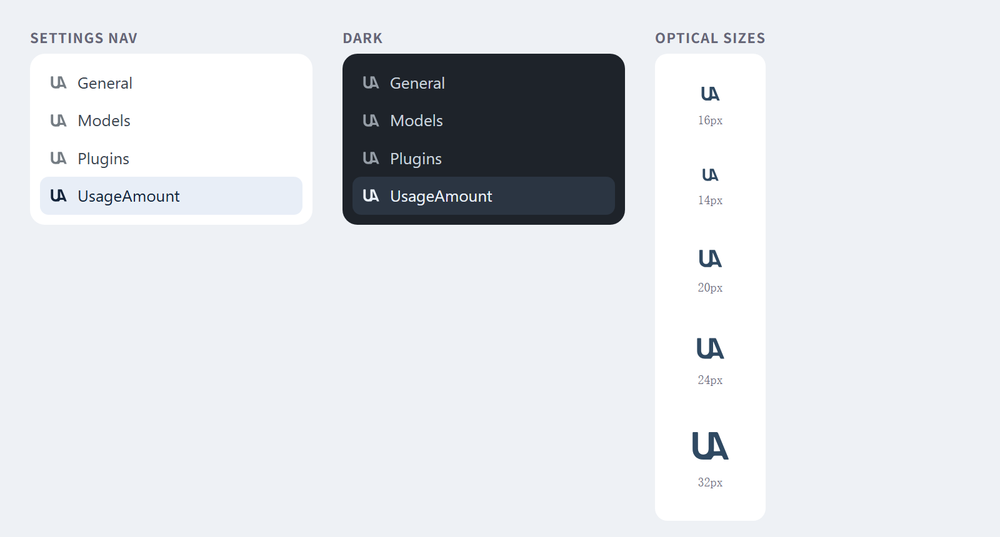

# dsh-show-usage-amount

两处界面，同一份 token 数据：

1. **对话框下方**（输入卡片底部的 composer dock）——当前对话已使用的 token 总量，点击展开明细。
2. **设置 → UsageAmount**——每个对话的 token 用量列表，最上方一排三张卡：总用量、当日用量、总任务用时。



## 对话框下方的徽标

| 位置 | 内容 |
| --- | --- |
| 徽标本体 | `24.6K tokens`——整段会话累计的 token（输入 + 缓存读 + 缓存写 + 输出） |
| 悬停提示 | `本次对话已用 24,612 tokens`（完整数字） |
| 点击展开 | 输入（未缓存）/ 缓存读取 / 缓存写入 / 输出 / 合计 / 缓存命中率 / 当前上下文 |

「当前上下文」是 `下一次请求的提示词预估 / 模型上下文窗口`。

## 设置 → UsageAmount

最上方是一排三张圆角矩形卡片：

| 卡片 | 内容 | 脚注 |
| --- | --- | --- |
| 总用量（宽卡） | 全部对话的 token 合计（输入 + 缓存读 + 缓存写 + 输出），右侧三分之二是一张十日折线图 | 对话个数 |
| 当日用量 | 按**本地日期**切出的今天用量 | `本地时间 2026-11-09` |
| 总任务用时 | 已结束任务（turn）的累计耗时 | 任务轮数 |

宽卡里那根折线是**最近 10 天**的每日总用量，画在卡片右三分之二、数字背后当背景，而不是另起一块堆在下面：

- 每天一个点，横轴固定 10 格——所以两次打开看到的形状可以直接比，不会因为数据多少而重新缩放；
- 纵轴以这 10 天的峰值为满格，顶部留 12% 余量，0 用量的日子压在基线上；
- 线条是**蓝色**（`--dsw-alias-state-business-primary`），配一道自上而下淡出的渐变填充——顶部 22% 透明度渐隐到基线全透明，所以它读起来是背景而不是一块实心色块；三条虚线是 25/50/75% 的参考线，基线上还有一条实线兜底；
- 曲线用**单调三次样条**（Fritsch–Carlson）平滑：切线被限制在相邻斜率的 3 倍以内，所以曲线永远不会冲出数据——既不会在连续两个空闲日之间掉到基线以下，也不会越过峰值日。普通的 Catmull-Rom 在这两点上都会骗人。一段连续零值会被压成一条直线；
- 最后一天有个圆点标记。它用 CSS 定位而不是画在 SVG 里，因为 SVG 的 viewBox 被 `preserveAspectRatio="none"` 非等比拉伸，`<circle>` 会被压成扁椭圆。

卡片下方是一条四桶明细（输入 / 缓存读取 / 缓存写入 / 输出 + 按 token 加权的整体缓存命中率），再下面是用量构成图与逐对话列表：

| 区域 | 内容 |
| --- | --- |
| 用量构成图 | 一条总占比堆叠条 + 各对话占比横条 + 图例 |
| 下方列表 | 每个对话一行：标题、输入、缓存读取、输出、合计、最近活动时间 |

行按合计用量从大到小排序。整体缓存命中率是**按 token 加权**的（`Σ缓存读 / Σ计费输入`），不是各对话百分比的算术平均——否则一个几乎没用量的小对话会把整体拉偏。没有用量记录的对话仍然出现，数值显示 `—`，并在列表下方给出说明。

三张卡里只有第一张的合计量来自 DSH 自带投影；折线、当日用量与任务用时都需要本插件的**宿主半侧**注册一个投影（见[当日用量与任务用时](#当日用量与任务用时)）。宿主半侧没装上时，折线不渲染、后两张卡显示 `—`，段落末尾的说明会换成「需要插件的宿主半侧」，而不是假装成 0。

### 图表怎么读

- **顶部堆叠条**是绝对占比：四段宽度 = 各桶 token / 全部合计，一眼看出钱花在哪。
- **下方每行一根横条**，按该对话自己的四桶构成切段，但**所有横条共用同一把尺**（取用量最多的那个对话作为满格）。所以横条长度可以横向比较——谁用得最多一目了然，同时仍能看到各自的构成。
- 某桶为 0 时不出色块，不留空条。

四种颜色都取自 DSH 主题变量，跟随明暗主题自动适配：

| 桶 | token | 语义 |
| --- | --- | --- |
| 缓存读取 | `--dsw-alias-state-success-primary` | 最便宜的批量命中 |
| 未缓存输入 | `--dsw-alias-state-business-primary` | 全价计费 |
| 缓存写入 | `--dsw-alias-state-warn-primary` | 溢价写入 |
| 输出 | `--dsw-alias-state-done-primary` | 生成 |

每个有用量的对话都会画一根横条，和下方表格逐行对应（早先版本只画前 8 个，和表格对不上，看起来像被截断了）。


### 窄窗口

设置面板在窄窗口里放不下六列。这时表格会折成每行一张带标签的卡片，数值不会被推到右边缘之外；三张卡也会重排——宽卡独占一行（折线仍然在它右侧三分之二），当日用量与任务用时共用下一行：



如果窄屏仍保持一排三张，两张小卡只剩约 91px，数字本身就会被截成 `1,369,…`——比换行更糟。所以这里让宽卡整行、另两张各占一半，每张都有足够宽度显示完整数字。

判定用的是**容器查询**（`@container` 在 `UsageAmount` 这一节自己的宽度上查询，阈值 560px），不是媒体查询——设置面板的宽度由侧边栏和窗口共同决定，和视口宽度不是一回事。`-section` 上声明了 `container: <prefix>-section / inline-size` 作为查询容器。

设置页在 **root scope** 里聚合：`ui-session` 把整张会话列表发布成 root 标准 hook `useSessions`，快照的每一行都带 `projectionValues`。`tokenUsage` 是投影注册表里的 **summary key**（它没有声明 `summary: false`），所以宿主在会话列表里就为每个对话带上了这份用量——设置页因此不必为每个对话挂载一个 session scope 才能读到。

## 数据来源

徽标与设置页的**总用量**读 DSH 自带的会话投影（projection），不自己算、不发任何模型请求：

- **`tokenUsage`** —— 由 `@deepseek-ai/dsh-token-meter` 发布，覆盖**整段持久日志**：分页加载与压缩都不会改变它。字段 `uncachedInputTokens` / `cacheReadTokens` / `cacheWriteTokens` / `outputTokens`。
- **`contextPressure`** —— 同一个包发布，`projectedTokens` 是下一次请求的提示词规模，`contextWindow` 是容量。注意它带 `summary: false`，所以只在**当前对话**的徽标面板里可用，设置页的跨对话列表读不到它。

两者缺失时（例如没挂载 token-meter），徽标直接不渲染，dock 不会留下空行；设置页则显示列表但每行都是 `—`。

## 当日用量与任务用时

`tokenUsage` 只有累计值，**不带任何时间维度**——它不按天分桶，也不知道一轮任务花了多久。所以后两张卡由本插件自己的宿主半侧（`lib/index.js`）注册一个新投影 `usageAmountDaily` 来提供：

| 字段 | 含义 | 怎么算 |
| --- | --- | --- |
| `days[YYYY-MM-DD]` | 按**本地日期**分桶的 token | 事件时间戳（`event.time`）落在哪一天就记到哪一天；只保留最近 10 天 |
| `activeMs` | 已结束任务的累计耗时 | `turn/end.time - turn/start.time`，只累计**已闭合**的 turn |
| `turns` | 已结束的任务轮数 | 每闭合一个 turn 加一 |

保留窗口是 **10 天**（`lib/index.js` 的 `DAY_WINDOW`）：设置页的折线正好画 10 天，更早的桶没有读者，留着只会让状态变大。若想更省，把它改小即可——折线上那些日子会变成基线，而不会出错。

几个关键取舍：

- **按事件时间而不是墙钟跨度**。会话可能跨夜、可能闲置几小时，用「最后活动时间 − 创建时间」会把空闲时间算成任务用时。
- **只算闭合的 turn**。正在跑的那一轮还没结束，算进去会得到一个不断跳动的数字。
- **token 按 `(turn, step)` 替换而非累加**。同一 step 可能因为重试或流式重放再发一次 `assistant/message`；先减旧样本再加新样本，才不会重复计费。
- **`apply` 里兜了 try/catch**。投影在宿主处理会话事件的同步路径上执行，抛异常会污染整个事件流——坏事件宁可跳过，不能打断会话。
- **`stateVersion` 与 schema 都会校验**。宿主把投影状态写进 checkpoint，冷会话恢复时用 `stateSchema.parse` 校验；版本不匹配就整条丢弃、从头重放，没有迁移。

它没有声明 `wire.summary: false`，因此和 `tokenUsage` 一样是 summary key，会出现在每个会话列表行的 `projectionValues` 里——设置页才能在 root scope 里跨对话聚合。

## 为什么落在 `conversation.composer.dock`

这个 slot 由 `@deepseek-ai/dsh-client-ui-conversation` 声明为 `list` + `session` scope，渲染在输入卡片正下方的 dock 行里，与内置的「会话统计」「上下文占用」胶囊并排。注册 `order: 2` 排在它们之后（activity=0、usage=1），因此不会挤走原有控件；窄屏时由 dock 自身的 `flex-wrap` 折行。

## 为什么落在 `settings.section`

由 `@deepseek-ai/dsh-client-ui-settings-general` 声明为 `list` + root scope，是设置面板的导航项与页面主体。注册 `order: 20` 排在 general(0) / models(10) / plugins(15) 之后。

## 导航图标

设置页左侧那一行用的是 `src/icon.png` 里那个「UA」字标，不是外壳的默认齿轮。



外壳按 **section 的 id** 去 `settings.section.icon` 里找图标，找不到就静默回落到齿轮——所以图标条目的 `id` 必须和 section 条目完全一致（都是 `show-usage-amount`），否则图标永远不出现且没有任何报错。

图标是矢量而非位图：位图缩到 14px 会糊，而 path 用 `fill="currentColor"` 就能跟着导航文字的颜色走，选中/未选中、明/暗主题都不用另做一套。

### 字标是怎么来的

`src/icon-glyph.svg` 由 `src/icon.png` 描摹得到，两个子路径（U、A）合成一条 path，靠 `fill-rule="evenodd"` 让 U 的碗底与 A 的三角自动成为孔洞：

| 步骤 | 为什么 |
| --- | --- |
| 亮度阈值 | 字标是白底单色平面填充，阈值化不丢信息 |
| 上采样后再阈值 | 让边缘按亚像素采样，而不是锁死在源图 116px 的网格上 |
| marching squares 取轮廓 | 得到闭合折线 |
| 圆形滑动平均（6 遍 / 窗口 9） | 直线段在滑动平均下仍是直线，像素阶梯噪声被抹平——A 的斜边就是这样变成一条干净直线的 |
| Douglas-Peucker（容差 0.30 原始像素） | 2316 + 556 个点压到 53 + 12 个，path 871 字符 |

容差扫描：`0.20 → IoU 0.9954`（点数 133/47，2440 字符）、`0.30 → 0.9930`（57/17）、`0.45 → 0.9907`（37/9）、`0.8 → 0.9835`（29/5）。取 0.30 是因为再往下压点数换来的清晰度提升在 14px 下已看不出来，而 path 会明显变长。

在源图自己的像素网格上复算：**IoU 0.9549**，漏 62px / 多 179px（多出的都在抗锯齿边缘），平均覆盖误差 0.0277。多出来的边缘像素不是形状偏移——做过 ±0.5px 的亚像素平移搜索，最优偏移仅把 IoU 提到 0.9796，说明这是阈值化把抗锯齿半透明边缘算作墨迹所致。

`lib/client.js` 里内联的是同一条 path（不是运行时读文件），`test-client.mjs` 断言内联值与 `src/icon-glyph.svg` 逐字节一致，避免改了 SVG 忘了同步 bundle。

## 安装

```powershell
node install.mjs
```

脚本会把本目录复制到 `%DSH_HOME%\profiles\desktop\node_modules\dsh-show-usage-amount`，并把包名写进 profile `package.json` 的 `dependencies` 与 `dsh.profile.bundles`。装完**重启 DSH**。

包的 `dsh.bundle.patch` 指向自带的 `cordis.patch.yml`，宿主启动时会把它插进配置树——不需要手改 profile 的 `cordis.patch.yml`。

## 卸载

从 profile `package.json` 的 `dsh.profile.bundles` 与 `dependencies` 里删掉 `dsh-show-usage-amount`，再删除 `node_modules\dsh-show-usage-amount`，然后重启 DSH。

## 自检

```powershell
node test-client.mjs
node test-host.mjs
```

`test-client.mjs` 在 Node 里用替身 React 跑 `lib/client.js`，断言：

- 插件 id 与 `inject` 依赖；
- 三个 slot 注册：`conversation.composer.dock`（`order: 2`）、`settings.section`（`order: 20`、导航 label 为 `UsageAmount`）与 `settings.section.icon`（id 必须与 section 一致，共享 locale 命名空间）；
- 图标：渲染成 `<svg>`、`viewBox` 为描摹结果、跟随 `size` 与 `currentColor`、两个闭合子路径、未选中时降低不透明度；
- 徽标 `24.6K` 的紧凑格式，以及无投影时不渲染；
- 设置页的跨对话聚合：三行合计 `3,000`、按 token 加权的整体缓存命中率 `90%`、对话计数、无用量行显示 `—`；
- 三张卡：`Total usage | 3,000 | 3 conversations`、`Today | 200 | local time <今天>`、`Total task time | 1h 30m | 4 turns`；宿主半侧缺席时后两张显示 `—` 而不是 `0`；
- 十日折线：10 个点、首尾贴住 0 与 100、无用量日压在基线（y=100）、面积沿基线闭合、三条参考线 + 一条基线、蓝色线条、渐变填充、末端圆点按百分比定位、`aria-label` 带天数与峰值；
- 平滑守卫：曲线用 `C` 段拼接，且**路径里每一个 y（含贝塞尔控制点）都落在 `12..100` 内**——这条断言是防止有人换成 Catmull-Rom 后曲线冲出数据；
- 图表几何：总堆叠条 `cache 45% / input 5% / output 50%`（零桶不出段）、横条共用满格 `2,000` 这把尺（`beta cache 22.5%`）；
- 布局守卫：三张卡在 `minmax(0, 2fr) minmax(0, 1fr) minmax(0, 1fr)` 网格里、折线绝对定位在 `left: 34%`（即右三分之二）、`barTrack` / `stack` 是 flex 容器、表格 `overflow-x: auto`、标题列不 `nowrap`、窄面板容器查询存在且重排成两列（宽卡 `grid-column: 1 / -1`）、窄屏脚注改为换行。

`test-host.mjs` 用正则剥掉 `export` 关键字后直接求值 `lib/index.js`，断言投影折叠逻辑：跨天分桶互不污染、`activeMs` 累加、开着的 turn 不计时不计轮、同一 `(turn, step)` 替换不重复计、重试后重新累加、14 天只保留 10 天且最新一天留下、checkpoint JSON 往返、脏 state 归一、`ctx.inject` 注册与失败告警。

## 结构

| 文件 | 作用 |
| --- | --- |
| `package.json` | `dsh.bundle.patch` 声明 bundle；`dsh.client.platform: web` + `exports["./client"]` 让模块系统把浏览器 half 发布到 `/plugins/dsh-show-usage-amount/client.js` |
| `cordis.patch.yml` | 把 `show-usage-amount` 行插进 profile 配置树 |
| `lib/index.js` | 宿主 half：注册 `usageAmountDaily` 投影（当日用量、任务用时），并提供激活日志 |
| `lib/client.js` | 浏览器 half：注册 composer dock 徽标、`settings.section` 页与 `settings.section.icon` 导航图标；读 `tokenUsage` / `contextPressure` / `usageAmountDaily` / `useSessions` |
| `src/icon.png` | 原始「UA」字标（白底深蓝），图标的来源 |
| `src/icon-glyph.svg` | 从 `icon.png` 描摹出的矢量字标；`lib/client.js` 内联的是同一条 path |
| `install.mjs` | 安装 / 覆盖更新到 profile（跳过 `test-*.mjs` 与 `scratch/`） |
| `test-client.mjs` | 浏览器 half 的冒烟测试 |
| `test-host.mjs` | 宿主 half 的投影折叠测试 |

`lib/client.js` 是 `__ModuleLoader__` 的 CJS 工厂脚本：**不能有顶层 import/export**，`react` 从 `require` 取（`react`、`react-dom`、`@deepseek-ai/dsh-client-ui-primitives` 都是外壳提供的静态种子模块，不需要写进 `dsh.client.external`）。

## 改动后如何生效

- 改 `lib/client.js`：刷新页面即可（模块系统按文件 mtime/ctime/size 生成 revision）。
- 改 `lib/index.js`（宿主 half）：需要重启 DSH。投影注册发生在 Loader 行启动时，且 `stateVersion` 不变时旧的 checkpoint 会继续被复用。
- 改 `src/icon-glyph.svg`：需要把新 path 同步进 `lib/client.js` 的 `GLYPH_PATH`（`test-client.mjs` 的逐字节断言会拦住不一致），再刷新页面。
- 改 `package.json` 或 `cordis.patch.yml`：需要重启 DSH，宿主只在 Loader 行启动时读 manifest。

## 改名说明

本插件原名 `dsh-token-badge`，已整体迁移并改名为 `dsh-show-usage-amount`：包名、插件 id、slot id（`show-usage-amount`）、locale 命名空间（`showUsageAmount`）与 CSS 类名前缀（`dsh-show-usage-amount-*`）都随之更新。
